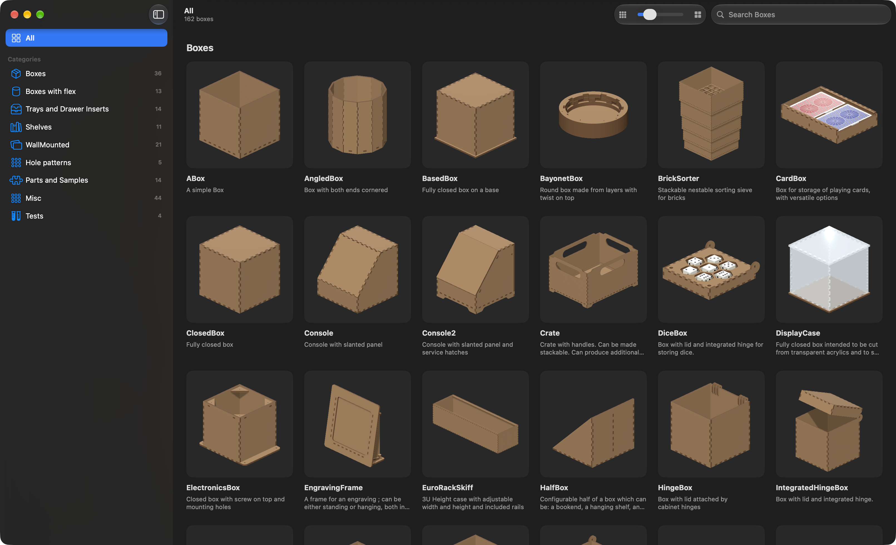

<p align="center">
  
</p>

<h1 align="center">LaserBox</h1>

<p align="center">
  A Mac app for designing laser-cut boxes, shelves, trays and parts, seen flat and assembled in 3D.<br>
  Built with SwiftUI and SceneKit around <a href="https://github.com/florianfesti/boxes">boxes.py</a>, which runs offline inside the app.
</p>

<p align="center">
  
</p>

## Features

- **Gallery**: 162 boxes.py generators in nine categories (Boxes, Boxes with flex, Trays and Drawer Inserts, Shelves, WallMounted, Hole patterns, Parts and Samples, Misc, Tests), or all of them under All, each card a 3D model of the assembled object that you can drag to turn and click to open.
- **Search Boxes**: filters the gallery by name, summary or the generator's class name; the slider in the toolbar sets the card size.
- **Parameters**: each generator's settings in an inspector, with readable labels and their help text; the edge settings are in collapsed sections. Values you change are kept per generator while the app runs. **Reset to Defaults** is in the inspector and in the Edit menu.
- **Cut Sheet**: the drawing as a blueprint (pinch to zoom), redrawn as you type. Every piece is labelled with its name (the `labels` setting turns this off), and the parts are packed onto a sheet shaped like a laser bed, 2 mm apart by default (`spacing`).
- **Assembled**: the same parts put together in 3D, with toolbar toggles for **Decorations** (what goes in the box but isn't cut), **Lids** and **Exploded View**, and a **Material** menu: six woods (MDF by default), seven acrylic colours and seven transparent acrylics.
- **About This Box**: a text-only panel with the generator's summary and a long description; LaserBox adds its own for the 86 generators boxes.py ships without one.
- **Export**: **Export SVG…** (⌘E) and **Export DXF…** (⇧⌘E), from the File menu or the Export button.
  - SVG is what boxes.py draws, with the labels.
  - DXF is R12 in millimetres: every path as lines, one layer per stroke colour, no text.
- **FrontPanel editor**: the FrontPanel generator's layout edited as panels and holes (Rectangle, Round hole, Mounting hole, Text, NEMA motor) with labelled fields instead of as text.
- **Languages**: English and Italian, including boxes.py's own texts.

## Requirements

- macOS 14 or later to run; Liquid Glass toolbars on macOS 26.
- Xcode 26 or later (the app uses the macOS 26 SDK).
- [Homebrew](https://brew.sh) on Apple silicon, for the build tools:

```bash
brew install xcodegen uv gettext
```

- `xcodegen` generates `LaserBox.xcodeproj` from [project.yml](project.yml).
- `uv` installs the Python 3.13 that is copied into the app.
- `gettext` provides `msgfmt`, which compiles the translations; the build calls it at `/opt/homebrew/bin/msgfmt`.

A network connection is needed once, to fetch boxes.py and its dependencies.

## Installation

```bash
git clone https://github.com/giuliomaffei90/LaserBox.git
cd LaserBox
scripts/bundle-runtime.sh
xcodegen generate
xcodebuild -project LaserBox.xcodeproj -scheme LaserBox -configuration Release -derivedDataPath build build
open /Applications/LaserBox.app
```

[scripts/bundle-runtime.sh](scripts/bundle-runtime.sh) builds `Runtime/`: it fetches boxes.py at a pinned commit
(`BOXES_REF`), applies a few fixes to its generators with `sed` and `perl` (each one commented in the script),
copies a relocatable Python 3.13 installed by `uv`, installs boxes.py and its dependencies into `Runtime/site`,
removes the parts of the standard library the app never uses and precompiles the bytecode. The app runs Python
with `-B` from its signed, read-only bundle, so the bytecode is compiled with unchecked hashes and never rewritten.

The build copies `Runtime/` into the app, compiles [Translations/it.po](Translations/it.po) into the bundle,
then replaces `/Applications/LaserBox.app` with the new build and signs it ad hoc.

For development, open the generated project with `open LaserBox.xcodeproj`. The project file is not in git: run
`xcodegen generate` again after adding or removing files.

## How it works

1. At launch [BoxModel.swift](LaserBox/BoxModel.swift) starts [Bridge.swift](LaserBox/Bridge.swift), which runs
   the bundled `Runtime/python/bin/python3 -s -B bridge.py` with `PYTHONPATH=Runtime/site` and `LASERBOX_LANG`
   set to the app's language.
2. [bridge.py](LaserBox/bridge.py) stays running and answers one JSON request per line on stdin: `list`, `args`,
   `render` and `assemble`.
3. `list` gives the generators by category. Before the gallery shows, the app asks `assemble` for every card with
   the default settings, three at a time, and caches the result in
   `~/Library/Caches/com.giuliomaffei.LaserBox/Gallery/`, in a folder named after a hash of `assembly.py` and
   `bridge.py`, so a new build starts with a fresh cache.
4. Opening a box sends `args`: the generator's argparse options, with readable labels, translated help and its
   long description (from [descriptions.py](LaserBox/descriptions.py) when boxes.py has none). The inspector is
   built from them.
5. Every change, 250 ms after the last keystroke, sends `render`: bridge.py runs the generator with the
   reference rectangle and QR code off, labels each piece, packs the parts and returns the SVG for the Cut Sheet.
6. In the Assembled view, `assemble` runs the generator and the recipe for it in
   [assembly.py](LaserBox/assembly.py). The recipe places each cut part in 3D, plus decorations such as the
   things that go in the box, and returns them as polygons with a thickness. The app extrudes them in SceneKit.
7. Export sends `render` with `svg` or `dxf`. The DXF is converted from the SVG by `svg_to_dxf` in bridge.py.

## Updating boxes.py

boxes.py is pinned to one commit. To move to another one, rebuild the runtime with its hash:

```bash
BOXES_REF=<commit> scripts/bundle-runtime.sh
```

If upstream changed the lines a fix in the script targets, `sed` changes nothing and doesn't fail, so check the
fixes still apply. The 3D recipes in `assembly.py` rely on the order in which each generator draws its parts, so
also check the Assembled view of the generators that changed.

## Known limitations

- The 3D views are worked out from what each generator draws: some parts are approximated or left out, and
  hardware such as screws, hinges or electronics is only shown where a decoration models it. The open questions
  are listed, in Italian, in [3D-REVIEW.md](3D-REVIEW.md).
- Not every boxes.py generator is in the app: the Unstable group, the Otto robot's parts and a few others are
  left out.
- The reference rectangle and the QR code that boxes.py can add to a drawing are always off.
- Changed parameters are lost when the app quits.
- DXF export turns curves into short lines (0.1 mm tolerance), leaves text out, and expects the untransformed
  absolute paths boxes.py writes today.
- In English, many parameters still show boxes.py's raw argument names (for example `canheight`).
- The first launch after each build prepares the 3D model of every gallery card before the gallery shows.
- The build expects Homebrew under `/opt/homebrew`, that is, a Mac with Apple silicon.
